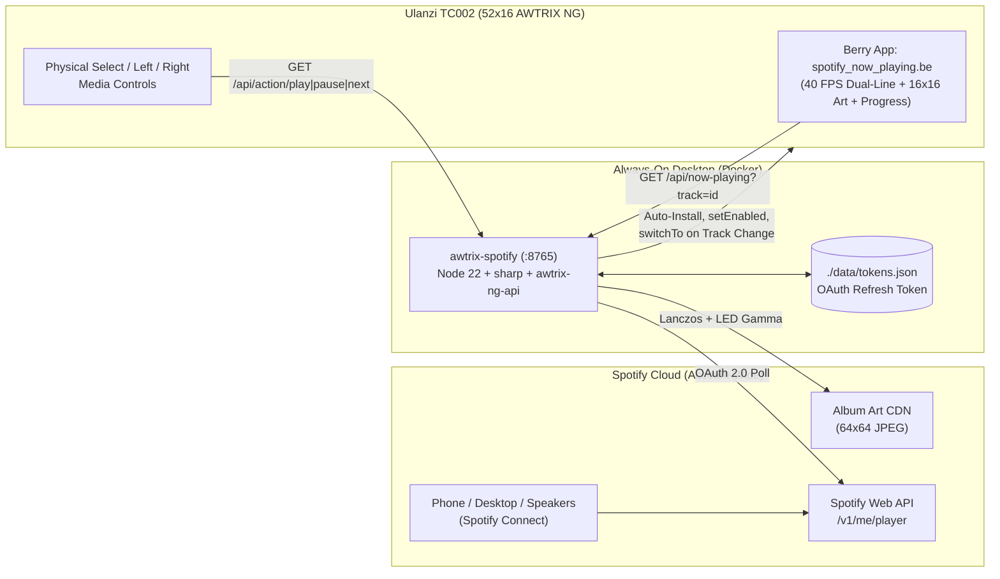

# supreme-bassoon

Spotify **Now Playing** bridge + native **AWTRIX NG Berry** display app purpose-built for the **Ulanzi TC002 (`52×16`)** Smart Pixel Clock (also backward-compatible with `32×8` TC001 panels).

[](LICENSE)


---

## Features

- **Live `16×16` Pixelated Album Art:** Downloads Spotify's compact cover art, applies Lanczos3 downsampling, clamps near-black LED noise to `0x000000`, and boosts color saturation so covers pop cleanly on RGB matrices.
- **Dynamic Album Accent Colors:** Extracts a high-contrast dominant hue from each album cover to tint the Artist line and bottom progress bar (falling back to Spotify green `#1DB954` on monochrome covers).
- **`40 FPS` Dual-Line Berry Renderer:** Runs natively on the clock (`berry/spotify_now_playing.be`) so the Song Title (top row) and Artist (second row) scroll smoothly and independently without flooding Wi-Fi.
- **Smart App Rotation:** Automatically enables the app in your clock's rotation when Spotify plays on *any* device (phone, desktop, smart speaker), switches immediately to the track when songs change, and removes itself from rotation after a brief grace period when paused.
- **Physical Button / Knob Controls:** Press the middle/knob button (`select`) on the TC002 to **Play / Pause** Spotify; optionally enable Left/Right **Prev / Next** track skipping via the AWTRIX NG Web UI.
- **Built-In Setup Dashboard & `52×16` Matrix Simulator:** Visit `http://127.0.0.1:8765` to connect Spotify in one click (with headless manual callback support) and preview the live `52×16` pixel matrix in your browser.

---

## Architecture



### `52×16` Pixel Layout (Ulanzi TC002)

```text
Columns: 0               15  16  17                                51
       ┌───────────────────┬───┬────────────────────────────────────┐
Row  0 │                   │   │                                    │
Row  1 │                   │   │  INSTANT CRUSH        (White 3x5)  │
  ..   │   16×16 Album     │ 1 │  ← independent smooth ticker       │
Row  5 │    Cover Art      │ p │                                    │
Row  6 │  (LED Gamma +     │ x │  (2px vertical breathing gap)      │
Row  8 │   Sat Boosted)    │   │  DAFT PUNK     (Album Accent Hue)  │
  ..   │                   │ G │  ← staggered smooth ticker         │
Row 12 │                   │ a │                                    │
Row 15 │                   │ p │  ████████████████████░░░░░░░░░░░░  │ ← 1px Progress Bar
       └───────────────────┴───┴────────────────────────────────────┘
```

---

## Quick Start

### 1. Create a Spotify Developer App

> **Important Spotify Developer Mode Rules:**
> 1. Your Spotify Developer account **must have an active Spotify Premium subscription**.
> 2. Spotify **bans `localhost`** in HTTP Redirect URIs — you **must** use `http://127.0.0.1:8765/callback`.

1. Go to the [Spotify Developer Dashboard](https://developer.spotify.com/dashboard) and click **Create app**.
2. Configure:
   - **Redirect URIs:** `http://127.0.0.1:8765/callback` *(click **Add**)*
   - Check **Web API** and click **Save**.
3. Copy your **Client ID** and **Client Secret** from the app's **Settings** page.

### 2. Configure `.env`

```bash
cp .env.example .env
```

Edit `.env` with your Spotify credentials, your TC002's LAN IP (`AWTRIX_HOST`), and your desktop's LAN IP (`SERVER_LAN_URL`):

```ini
SPOTIFY_CLIENT_ID=your_spotify_client_id_here
SPOTIFY_CLIENT_SECRET=your_spotify_client_secret_here
SPOTIFY_REDIRECT_URI=http://127.0.0.1:8765/callback

AWTRIX_HOST=192.168.1.50
AWTRIX_APP_NAME=spotify
AUTO_INSTALL_SCRIPT=true

PORT=8765
SERVER_LAN_URL=http://192.168.1.100:8765
```

### 3. Launch with Docker Compose

```bash
docker compose up -d --build
```

On boot, the container automatically installs `berry/spotify_now_playing.be` onto your AWTRIX NG clock and configures its `server_url` setting.

### 4. Authorize Spotify

Open **[http://127.0.0.1:8765](http://127.0.0.1:8765)** in your browser and click **Connect Spotify** (or expand *"Running on a headless machine?"* to paste the callback URL manually if signing in from another machine).

---

## Configuration Reference

| Variable | Default | Description |
| :--- | :--- | :--- |
| `SPOTIFY_CLIENT_ID` | *(required)* | Spotify Developer App Client ID |
| `SPOTIFY_CLIENT_SECRET` | *(required)* | Spotify Developer App Client Secret |
| `SPOTIFY_REDIRECT_URI` | `http://127.0.0.1:8765/callback` | Loopback OAuth callback URI |
| `AWTRIX_HOST` | *(required)* | Ulanzi TC002 LAN IP address |
| `AWTRIX_PORT` | `80` | AWTRIX NG HTTP port |
| `AWTRIX_USERNAME` / `AWTRIX_PASSWORD` | *(empty)* | Optional AWTRIX NG Web UI Basic Auth credentials |
| `AWTRIX_APP_NAME` | `spotify` | Script/app name on the clock |
| `AUTO_INSTALL_SCRIPT` | `true` | Auto-deploy & configure the Berry script on startup |
| `SERVER_LAN_URL` | `http://<detected-ip>:8765` | LAN URL the TC002 uses to poll this container |
| `POLL_ACTIVE_MS` | `2000` | Poll interval (ms) while music is playing |
| `POLL_IDLE_MS` | `5000` | Poll interval (ms) when paused/idle |
| `PAUSE_GRACE_MS` | `6000` | Delay (ms) before hiding the app after playback pauses |
| `SWITCH_ON_TRACK_CHANGE` | `true` | Immediately switch clock view to `spotify` when a new track starts |
| `ASCII_TRANSLITERATE` | `true` | Transliterate accents & smart quotes for clean bitmap font rendering |
| `LED_GAMMA` | `1.55` | Gamma curve for `16×16` album art on physical RGB LEDs |
| `LED_SATURATION` | `1.25` | Saturation multiplier for `16×16` album art |

---

## Development & Tests

```bash
npm install
npm test
```

## License

[MIT](LICENSE)
